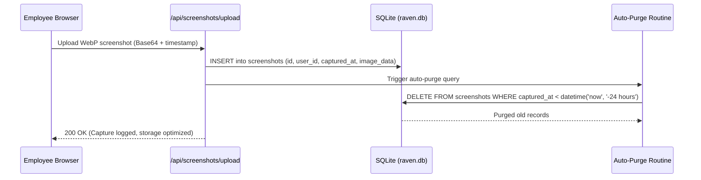

# Implementation Plan: '3-Eyed Raven' Web Platform

The **3-Eyed Raven** platform is an all-in-one employee monitoring, active screen time tracking, screenshot auditing, and Excel-driven workflow management web application.

---

## 1. Confirmed Architecture & Tech Stack Decisions

| Category                     | Decision                                             | Details                                                                                                                                                                    |
| ---------------------------- | ---------------------------------------------------- | -------------------------------------------------------------------------------------------------------------------------------------------------------------------------- |
| **Architecture**       | **Unified Next.js (App Router)**               | Single codebase containing both UI (React client components) and Backend (API Route Handlers`/app/api/*`). Zero CORS issues, single dev server.                          |
| **Styling & Theme**    | **Tailwind CSS + Adaptive Theme**              | Seamless toggle between**Dark Mode** and **Light Mode** with automatic system preference detection and localStorage persistence.                               |
| **Database & Storage** | **Self-Contained SQLite (`better-sqlite3`)** | Zero-configuration single file database (`data/raven.db`).                                                                                                               |
| **Screenshot Storage** | **Database BLOB / Base64 Storage**             | Compressed client-side (WebP 70% quality, ~80-120KB) and stored directly inside SQLite.                                                                                    |
| **Retention Policy**   | **Rolling 24-Hour / Today Only (Auto-Purge)**  | **Only current day's screenshots are kept.** Screenshots older than 24 hours are automatically purged on heartbeat/upload to keep the database lightweight and fast. |
| **Historical Data**    | **Permanent Screen Time & Tasks**              | `work_sessions` (daily/weekly/monthly active hours) and `tasks` / `task_sheets` records are **preserved permanently** for historical analytics.                |
| **Screenshot Capture** | **Web Screen Capture API**                     | Zero-software client using`navigator.mediaDevices.getDisplayMedia`. Prompts employee once on shift start.                                                                |
| **Capture Frequency**  | **Admin-Configurable Interval**                | Admin can set the capture interval (e.g. 1m for testing, 5m, 15m, 30m, 60m). Employees dynamically sync with this interval.                                                |
| **Task Management**    | **Dense Excel Data Table**                     | In-browser spreadsheet-style data table with inline row editing, search/filter (Status, Severity, Assignee), and progress sliders (0-100%).                                |
| **Excel Schema**       | **Custom Standard Schema**                     | Ingests`.xlsx` files with columns: `Task ID`, `Task Title`, `Assignee`, `Status`, `Severity`, `Deadline`.                                                    |

---

## 2. Storage & 24-Hour Screenshot Retention Engine

To guarantee zero database bloat and eliminate privacy/storage concerns:



### Key Storage Features:

1. **Automated Rolling Cleanup**: Old screenshots older than 24 hours are deleted on every upload and heartbeat.
2. **Admin Storage Widget**: Displays live screenshot count, total storage estimated, and a manual **"Purge All Old Screenshots Now"** button.
3. **Historical Stats Intact**: `work_sessions` keeps duration counts, dates, and hours indefinitely, meaning weekly and monthly screen time charts remain complete.

---

## 3. Database Schema (SQLite)

```sql
-- Users (Admin and Employees share the same table)
CREATE TABLE users (
  id TEXT PRIMARY KEY,
  name TEXT NOT NULL,
  empid TEXT UNIQUE NOT NULL,
  email TEXT UNIQUE NOT NULL,
  pass TEXT NOT NULL,
  role TEXT NOT NULL CHECK(role IN ('ADMIN', 'EMPLOYEE')),
  created_at DATETIME DEFAULT CURRENT_TIMESTAMP
);

-- System Settings (Dynamic Capture Interval & Global Config)
CREATE TABLE settings (
  key TEXT PRIMARY KEY,
  value TEXT NOT NULL,
  updated_at DATETIME DEFAULT CURRENT_TIMESTAMP
);

-- Work Sessions (Permanent Screen time duration tracking)
CREATE TABLE work_sessions (
  id TEXT PRIMARY KEY,
  user_id TEXT NOT NULL,
  start_time DATETIME NOT NULL,
  end_time DATETIME,
  duration_seconds INTEGER DEFAULT 0,
  date TEXT NOT NULL, -- 'YYYY-MM-DD'
  status TEXT DEFAULT 'ACTIVE',
  FOREIGN KEY(user_id) REFERENCES users(id) ON DELETE CASCADE
);

-- Screenshots (24-hour rolling retention)
CREATE TABLE screenshots (
  id TEXT PRIMARY KEY,
  session_id TEXT NOT NULL,
  user_id TEXT NOT NULL,
  captured_at DATETIME NOT NULL,
  image_data TEXT NOT NULL, -- Compressed WebP Data URL
  width INTEGER,
  height INTEGER,
  FOREIGN KEY(session_id) REFERENCES work_sessions(id) ON DELETE CASCADE,
  FOREIGN KEY(user_id) REFERENCES users(id) ON DELETE CASCADE
);

-- Excel Task Sheets (Individual or Team)
CREATE TABLE task_sheets (
  id TEXT PRIMARY KEY,
  user_id TEXT NOT NULL,
  title TEXT NOT NULL,
  sheet_type TEXT NOT NULL CHECK(sheet_type IN ('INDIVIDUAL', 'TEAM')),
  created_at DATETIME DEFAULT CURRENT_TIMESTAMP,
  FOREIGN KEY(user_id) REFERENCES users(id) ON DELETE CASCADE
);

-- Individual Tasks extracted from Excel
CREATE TABLE tasks (
  id TEXT PRIMARY KEY,
  sheet_id TEXT NOT NULL,
  task_id TEXT NOT NULL,
  title TEXT NOT NULL,
  assignee TEXT NOT NULL,
  status TEXT NOT NULL, -- 'Pending', 'In Progress', 'Completed', 'Blocked'
  severity TEXT NOT NULL, -- 'Low', 'Medium', 'High', 'Critical'
  deadline TEXT,
  progress_percent INTEGER DEFAULT 0,
  daily_notes TEXT,
  updated_at DATETIME DEFAULT CURRENT_TIMESTAMP,
  FOREIGN KEY(sheet_id) REFERENCES task_sheets(id) ON DELETE CASCADE
);
```

---

## 4. Core UI Pages & Workflows

### A. Authentication (`/login`)

- Clean, responsive login card with 3-Eyed Raven branding.
- Light/Dark mode toggle in the header.
- Login using `Email` or `Emp ID` + `Password`.
- Automatically seeds default Admin (`admin@raven.local` / `admin123` / `EMP000`).

### B. Employee Dashboard (`/dashboard`)

1. **Live Work Session Bar**:
   - Status banner: "Shift Inactive" or "Shift Active (Recording)".
   - Start Work button -> triggers browser prompt `getDisplayMedia` to share entire screen.
   - Real-time digital clock timer (HH:MM:SS) showing active shift.
   - End Work button -> sends final shift summary, closes stream, updates DB.
2. **Screen Time Statistics**:
   - **Today's Hours**: Total hours logged today.
   - **Weekly Hours**: 7-day bar chart showing daily active breakdown.
   - **Monthly Hours**: Cumulative monthly hours vs target.
3. **Excel Task Sheet Manager**:
   - "Download Sample Excel Template" button (pre-filled with `Task ID, Task Title, Assignee, Status, Severity, Deadline`).
   - Drag-and-drop Excel file upload with mode selector: `[Personal Sheet]` / `[Team Sheet]`.
   - **Dense Data Table**:
     - Column sorting, search by keyword, filter by Status and Severity badge (`Critical` in Red, `High` in Orange, `Medium` in Yellow, `Low` in Blue).
     - Inline interactive progress bar slider (0% to 100%).
     - Quick status dropdown (`Pending`, `In Progress`, `Completed`, `Blocked`).
     - Daily notes field with instant auto-save.

### C. Admin Control Center (`/admin`)

1. **Workforce Monitor**:
   - Live cards showing currently active employees, shift start time, and active duration.
   - Latest snapshot thumbnail for each working employee.
2. **Interval Settings & Storage Monitor**:
   - Slider/dropdown to configure screenshot interval (e.g. 1 min, 5 min, 15 min, 30 min, 60 min).
   - Storage widget: active screenshot count + "Purge Old Screenshots" button.
3. **Today's Screenshot Audit Timeline**:
   - Filter by Employee (displays all captures from the last 24 hours / today).
   - Chronological grid of captured screenshots with time labels.
   - Click to open high-resolution modal with zoom/inspect view.
4. **Employee Management**:
   - Modal to create a new user: `Name`, `Employee ID`, `Email`, `Password`, `Role` (Admin or Employee).
   - Employee table with search, role badges, and status.
5. **Team Task Overview**:
   - View all uploaded individual and team Excel sheets.
   - Export updated task status and progress back to `.xlsx`.

---

## 5. Next.js Project Structure

```
Three-Eyed Raven/
├── src/
│   ├── app/
│   │   ├── api/
│   │   │   ├── auth/
│   │   │   │   ├── login/route.js
│   │   │   │   └── me/route.js
│   │   │   ├── users/route.js          # Admin user CRUD
│   │   │   ├── settings/route.js       # Interval settings & manual purge
│   │   │   ├── session/
│   │   │   │   ├── start/route.js
│   │   │   │   ├── heartbeat/route.js
│   │   │   │   ├── end/route.js
│   │   │   │   └── stats/route.js      # Daily, weekly, monthly screen time
│   │   │   ├── screenshots/
│   │   │   │   ├── upload/route.js     # Receive Base64 screenshot & trigger auto-purge
│   │   │   │   └── list/route.js       # Admin timeline query (today's captures)
│   │   │   └── tasks/
│   │   │       ├── upload/route.js     # Excel parser & sheet creator
│   │   │       ├── template/route.js   # Generates sample .xlsx
│   │   │       ├── update/route.js     # Progress & note updates
│   │   │       └── export/route.js     # Export back to Excel
│   │   ├── login/page.jsx
│   │   ├── dashboard/page.jsx
│   │   ├── admin/page.jsx
│   │   ├── layout.jsx
│   │   ├── page.jsx                    # Redirect to /login or /dashboard
│   │   └── globals.css
│   ├── components/
│   │   ├── Navbar.jsx                  # Header with Dark/Light toggle, user badge, logout
│   │   ├── ThemeToggle.jsx             # Light/Dark mode switcher
│   │   ├── SessionTracker.jsx          # getDisplayMedia handler & timer
│   │   ├── ScreenTimeStats.jsx         # Daily, weekly, monthly charts
│   │   ├── TaskDataTable.jsx           # Dense Excel data table with inline editing
│   │   ├── ScreenshotModal.jsx         # Fullscreen screenshot inspector
│   │   └── UserModal.jsx               # Admin user creation modal
│   ├── lib/
│   │   ├── db.js                       # SQLite initialization, migrations & auto-purge helper
│   │   ├── auth.js                     # JWT verification & password hashing
│   │   └── excel.js                    # SheetJS parsing & generation helpers
├── package.json
├── tailwind.config.js
└── next.config.js
```

---

## 6. Verification Plan

### Automated & Unit Tests

- Backend API tests:
  - Auth: Register (admin only), Login (returns JWT), Role authorization check.
  - Settings: Get & update capture interval.
  - Work Session: Start session, record duration, end session.
  - Auto-purge verification: Confirm screenshots older than 24h are deleted upon upload while preserving sessions and tasks.
  - Excel parser: Ingest `.xlsx` with schema `[Task ID, Task Title, Assignee, Status, Severity, Deadline]` and persist rows.

### Manual Verification

1. **Admin User Creation**: Log in as default admin -> create employee `EMP002`.
2. **Employee Session**: Log in as `EMP002` -> click "Start Work" -> approve browser screen share -> verify shift timer runs.
3. **Capture & Auto-Purge**: Set interval to 1 min -> verify captures appear in Admin timeline; test purge button.
4. **Excel Task Flow**: Download standard template -> upload -> edit progress and status -> export updated sheet.
5. **Screen Time Preservation**: End work session -> verify daily, weekly, and monthly screen time statistics remain intact.
